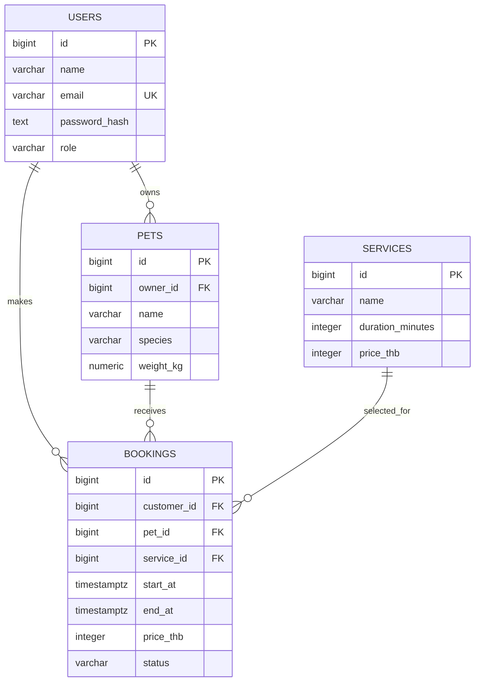

# PetGrooming — Database Contract

Version: 1.0 | PostgreSQL | Timezone: `Asia/Bangkok` for user-facing booking dates/times.

## 1. Entity relationships


## 2. Table definitions

### `users`
| Column | Type | Rules |
|---|---|---|
| id | BIGSERIAL | PK |
| name | VARCHAR(100) | NOT NULL |
| email | VARCHAR(255) | NOT NULL, UNIQUE, normalize to lowercase |
| password_hash | TEXT | NOT NULL; never store plaintext |
| role | VARCHAR(20) | NOT NULL, `customer` or `staff`; registration always creates customer |
| created_at | TIMESTAMPTZ | NOT NULL DEFAULT now() |

### `pets`
| Column | Type | Rules |
|---|---|---|
| id | BIGSERIAL | PK |
| owner_id | BIGINT | FK users.id, NOT NULL |
| name | VARCHAR(100) | NOT NULL |
| species | VARCHAR(10) | `dog` or `cat` |
| breed | VARCHAR(100) | nullable |
| weight_kg | NUMERIC(6,2) | > 0 |
| notes | VARCHAR(1000) | nullable; avoid unnecessary sensitive data |
| created_at | TIMESTAMPTZ | NOT NULL DEFAULT now() |

### `services`
| Column | Type | Rules |
|---|---|---|
| id | BIGSERIAL | PK |
| name | VARCHAR(100) | UNIQUE, NOT NULL |
| duration_minutes | INTEGER | > 0 |
| price_thb | INTEGER | >= 0 |
| active | BOOLEAN | NOT NULL DEFAULT true |

### `bookings`
| Column | Type | Rules |
|---|---|---|
| id | BIGSERIAL | PK |
| customer_id | BIGINT | FK users.id, NOT NULL |
| pet_id | BIGINT | FK pets.id, NOT NULL |
| service_id | BIGINT | FK services.id, NOT NULL |
| start_at | TIMESTAMPTZ | NOT NULL, stored as instant (UTC internally) |
| end_at | TIMESTAMPTZ | NOT NULL, must be later than start_at |
| price_thb | INTEGER | NOT NULL, captured from service at booking time |
| status | VARCHAR(20) | confirmed/in_progress/completed/cancelled |
| created_at | TIMESTAMPTZ | NOT NULL DEFAULT now() |
| updated_at | TIMESTAMPTZ | NOT NULL DEFAULT now(); update in application or trigger |

`customer_id` must equal the selected pet's `owner_id`. Verify this in the authenticated backend transaction; never trust a customerId sent by the browser.

## 3. Migration SQL (reference implementation)
Save the following in `database/migrations/001_init.sql` when implementing. The markdown fence is for documentation only.

```sql
CREATE EXTENSION IF NOT EXISTS btree_gist;

CREATE TABLE users (
  id BIGSERIAL PRIMARY KEY,
  name VARCHAR(100) NOT NULL,
  email VARCHAR(255) NOT NULL UNIQUE,
  password_hash TEXT NOT NULL,
  role VARCHAR(20) NOT NULL DEFAULT 'customer'
    CHECK (role IN ('customer','staff')),
  created_at TIMESTAMPTZ NOT NULL DEFAULT now()
);

CREATE TABLE pets (
  id BIGSERIAL PRIMARY KEY,
  owner_id BIGINT NOT NULL REFERENCES users(id),
  name VARCHAR(100) NOT NULL,
  species VARCHAR(10) NOT NULL CHECK (species IN ('dog','cat')),
  breed VARCHAR(100),
  weight_kg NUMERIC(6,2) NOT NULL CHECK (weight_kg > 0),
  notes VARCHAR(1000),
  created_at TIMESTAMPTZ NOT NULL DEFAULT now()
);

CREATE TABLE services (
  id BIGSERIAL PRIMARY KEY,
  name VARCHAR(100) NOT NULL UNIQUE,
  duration_minutes INTEGER NOT NULL CHECK (duration_minutes > 0),
  price_thb INTEGER NOT NULL CHECK (price_thb >= 0),
  active BOOLEAN NOT NULL DEFAULT true
);

CREATE TABLE bookings (
  id BIGSERIAL PRIMARY KEY,
  customer_id BIGINT NOT NULL REFERENCES users(id),
  pet_id BIGINT NOT NULL REFERENCES pets(id),
  service_id BIGINT NOT NULL REFERENCES services(id),
  start_at TIMESTAMPTZ NOT NULL,
  end_at TIMESTAMPTZ NOT NULL,
  price_thb INTEGER NOT NULL CHECK (price_thb >= 0),
  status VARCHAR(20) NOT NULL DEFAULT 'confirmed'
    CHECK (status IN ('confirmed','in_progress','completed','cancelled')),
  created_at TIMESTAMPTZ NOT NULL DEFAULT now(),
  updated_at TIMESTAMPTZ NOT NULL DEFAULT now(),
  CONSTRAINT booking_positive_duration CHECK (end_at > start_at),
  CONSTRAINT booking_no_overlap EXCLUDE USING gist
    (tstzrange(start_at, end_at, '[)') WITH &&)
    WHERE (status <> 'cancelled')
);

CREATE INDEX bookings_customer_idx ON bookings(customer_id, start_at DESC);
CREATE INDEX bookings_date_idx ON bookings(start_at);
CREATE INDEX pets_owner_idx ON pets(owner_id);
```

**Why the exclusion constraint matters:** Two concurrent requests might both see an empty slot. The database must reject the second overlapping insert with SQLSTATE `23P01`; map this to HTTP 409 with code `SLOT_UNAVAILABLE`. The `[)` interval allows back-to-back appointments (09:00–10:00 then 10:00–11:00). Completed historical bookings remain protected; cancelling a future booking releases its slot.

## 4. Time and pricing
- Browser/API use `date: YYYY-MM-DD` and `startTime: HH:mm` in `Asia/Bangkok`.
- Backend converts to `TIMESTAMPTZ`, calculates `end_at` using `services.duration_minutes`, and returns local `date`, `startTime`, `endTime`.
- Server checks that the entire appointment is within 09:00–18:00 and start time is a 30-minute boundary.
- Server copies `services.price_thb` to `bookings.price_thb`, preserving historical prices after service-price changes.
- Example fixture: bath service ID 1, 2026-09-26 09:00–10:00 Bangkok time = 2026-09-26 02:00–03:00 UTC. This example is not a valid future booking once the date has passed.

## 5. Suggested seed data
```sql
INSERT INTO services (name, duration_minutes, price_thb) VALUES
 ('อาบน้ำ', 60, 300),
 ('ตัดขน', 90, 450),
 ('ตัดเล็บ', 20, 100),
 ('อาบน้ำ + ตัดขน', 120, 650);
```
Create a staff account through a dedicated seed script with a **hashed** password supplied by environment variable; never put a real password or JWT secret in the repository.

## 6. Database tests
1. Insert 09:00–10:00 booking, then try 09:30–10:30: second insert must fail with `23P01`.
2. Insert 10:00–11:00 after 09:00–10:00: succeeds.
3. Cancel 09:00–10:00 then insert another 09:00–10:00: succeeds.
4. Restart database container: existing records remain in a named volume.
5. Backend rejects a booking when `pet.owner_id` differs from authenticated user.
6. Two concurrent inserts for the same slot: exactly one succeeds.
